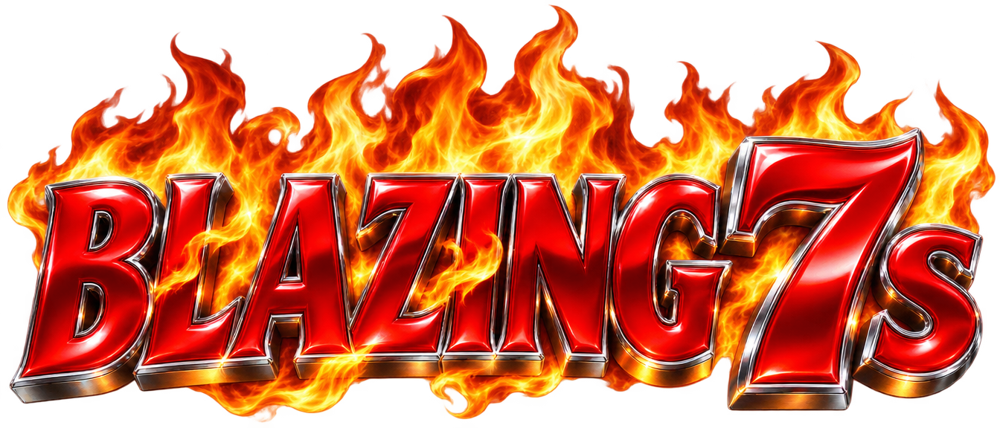
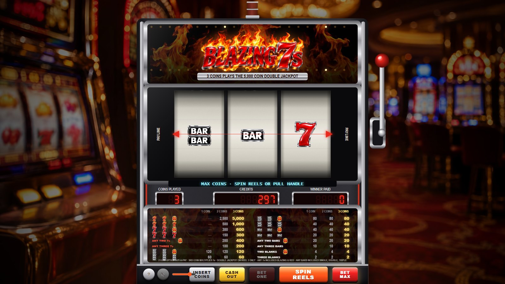
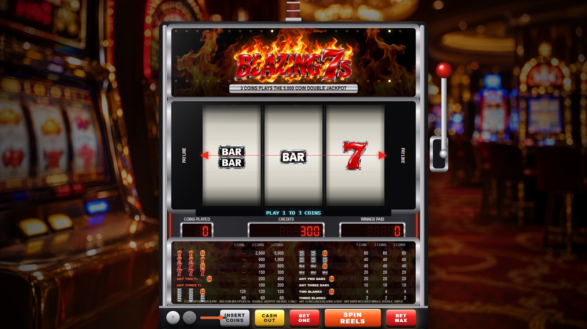
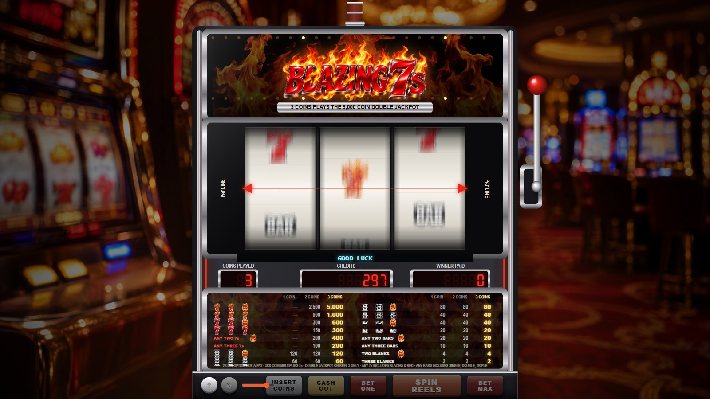
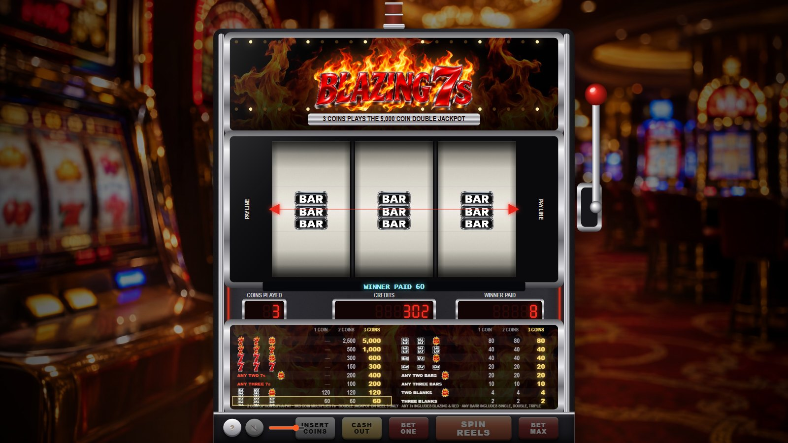
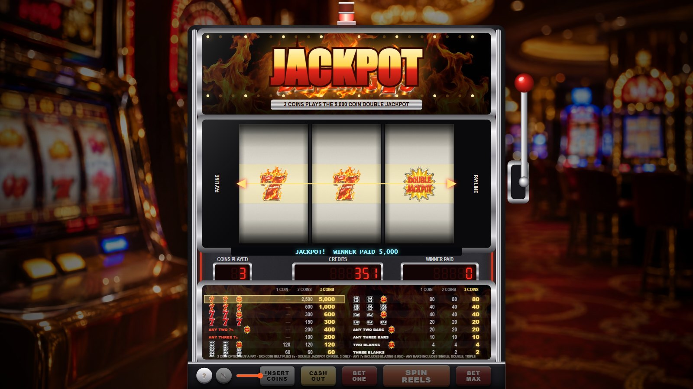
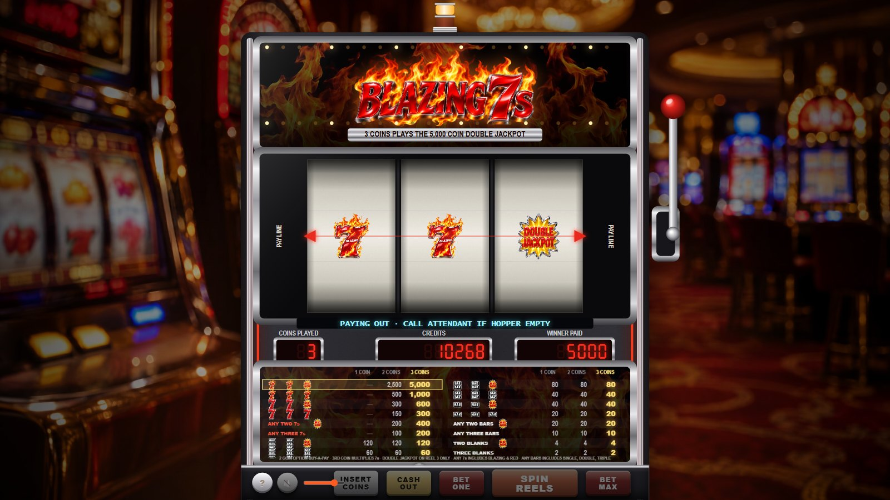
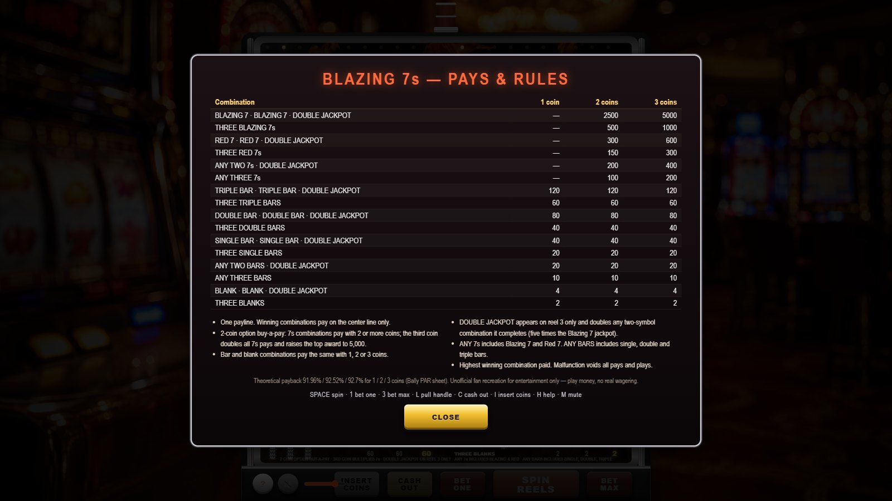

<div align="center">



### A photorealistic recreation of the classic three-reel *Blazing 7s* stepper — one payline, three coins, Double Jackpot




</div>

Plain HTML5 Canvas, Web Audio and vanilla JavaScript — no frameworks, no build
step. The reels are real **weighted virtual-reel steppers**: 22 physical stops
per reel (symbol, blank, symbol, blank…) mapped from the 72 virtual stops of
the actual Bally PAR sheet, so near-misses, hit frequency (12.05 %, one win in
8.3 pulls) and the paybacks of **91.96 % / 92.52 % / 92.70 %** for 1 / 2 / 3
coins are the machine's own. Every sound is synthesized live; the artwork was
generated for this project.

> Unofficial fan recreation for entertainment only. Blazing 7s is a trademark of
> its owner. Play money, no real wagering.

---

## Contents

1. [Features](#features)
2. [Platforms](#platforms)
3. [Installation](#installation)
4. [Configuration reference](#configuration-reference)
5. [User guide](#user-guide)
6. [Keyboard shortcuts](#keyboard-shortcuts)
7. [Known limitations](#known-limitations)
8. [Project layout](#project-layout)
9. [Development](#development)

---

## Features

**The machine**

* Three reels, one center payline, 1–3 coins per pull; BET ONE, BET MAX (spins
  at once), SPIN REELS, a working pull handle, CASH OUT and INSERT COINS
* 2-coin *option buy-a-pay*: 7s combinations pay only with 2 or more coins, the
  third coin doubles every 7s pay and raises the top award to **5,000**
* The **DOUBLE JACKPOT** symbol on reel 3 completes any two-of-a-kind for double
  pay and turns two Blazing 7s into the 5,000-coin jackpot
* Any-7s and any-bars mixed pays, and the famous "three blanks pay 2"
* Jackpot celebration: candle flashing, chasing lamps, siren and bells
* Hopper cash-out with coins tumbling into the tray and a rattling hopper motor

**Mechanics**

* Virtual-reel weighting straight from the PAR sheet (Blazing 7s Double JP /
  Bars, 2-coin O.B.P. with 3CM, Bally Gaming 2002): B7 2/2/23, R7 8/7/6, triple
  bar 6/6/3, double bar 11/11/6, single bar 17/17/9, blanks 28/29/24, one Double
  Jackpot on reel 3; 373,248 combinations
* Stepper physics: snap wind-up, fast acceleration, blurred spin, abrupt
  deceleration, small overshoot and a stiff spring settle; reels stop left to
  right 0.45 s apart with a clunk and the rising three-tone stop chime
* Outcomes drawn with the Web Crypto RNG and spliced into the moving strip
* Exact payback calculator and par-sheet report (`tools/rtp-sim.js`)

**Presentation**

* Upright cabinet with brushed-metal body, chrome rails, red accent strips,
  candle, chase-lamp top glass with flames, LED seven-segment meters, VFD
  message line, belly-glass pay table whose coin column lights for the coins
  played, printed paper reel strips on shaded drums behind reflective glass
* Lever with knob that swings on a pivot when pulled (mouse or `L`)

**Sound (Web Audio, no files)**

* Coin-in clinks, bet beeps, ratcheting lever, stepper motor whir and ticks,
  clunk-and-chime reel stops, credit-counting dings, win bells, jackpot siren,
  hopper motor and coin cascade, attract jingle; volume slider and mute

---

## Platforms

| Platform | Status | Notes |
| --- | --- | --- |
| Chrome / Edge (desktop) | Tested | Headless Chrome drives the smoke test and screenshots |
| Firefox (desktop) | Expected to work | Standard Canvas 2D and Web Audio only |
| Safari (macOS / iOS) | Expected to work | Audio unlocks on the first tap, as everywhere |
| Android / iOS browsers | Playable | The scene scales to the screen; landscape recommended |
| Offline / `file://` | Works | Open `index.html` directly; no network resources are required |

Requirements: a browser with Canvas 2D, Web Audio and ES2020. Node.js 22+ only
for the optional tools.

---

## Installation

1. **Get the files.** Download or clone this folder, keeping `assets/`, `css/`
   and `js/` beside `index.html`.
2. **Serve it (recommended).**

   ```bash
   python -m http.server 8766
   ```

   On Windows double-click `start.cmd`, which starts that server and opens the
   game. Browse to <http://localhost:8766/>.
3. **Or open from disk.** Double-click `index.html`; Chrome and Edge run it from
   `file://`.
4. **Click once** on the splash to unlock audio. You start with 200 credits;
   INSERT COINS adds 100 at a time.
5. **Optional URL parameters:** `?mute=1` starts silent; `?force=…` forces
   outcomes (see [Development](#development)).

### Configuration reference

| Setting | File | Default | Meaning |
| --- | --- | --- | --- |
| `startCredits`, `coinPack` | `js/config.js` | `200`, `100` | Credits on load, credits per INSERT COINS press |
| `maxCoins` | `js/config.js` | `3` | Coins per pull |
| `PAYTABLE` | `js/config.js` | Bally pay glass | Rows in evaluation order with pays for 1 / 2 / 3 coins |
| `STRIPS` | `js/config.js` | PAR sheet weights | 22 physical stops per reel as `[symbol, virtualWeight]`; weights per symbol must sum to the PAR counts |
| `payback` | `js/config.js` | `91.96 / 92.52 / 92.70` | Published figures shown in the help screen |
| `vmax`, `accelTime`, `overshoot`, `omega`, `zeta` | `js/game.js` (Reel options) | `23, 0.28, 0.12, 34, 0.6` | Spin speed (stops/s), acceleration, stop overshoot and spring |
| stop timing (`0.95 + i * 0.45`) | `js/game.js` `spin()` | 0.95 s first stop, 0.45 s apart | Reel stop cadence |
| payout counting | `js/game.js` `evaluate()` | 1 / 2 / 10 / 50 per tick, 75 ms | Credit counting speed by win size |
| jackpot threshold | `js/game.js` | `pay >= 1000` | Triggers candle, siren and JACKPOT banner |
| `b7.volume`, `b7.muted` | browser `localStorage` | `0.8`, `0` | Remembered volume and mute |

After changing strips or pays run `node tools/rtp-sim.js`; it recomputes the
paybacks exactly.

---

## User guide

### The cabinet



Top glass with the title and chasing lamps, the reel glass with the red payline
markers, a VFD message line, three LED meters (COINS PLAYED, CREDITS, WINNER
PAID), the belly-glass pay table and the button deck. The handle is on the
right.

### Betting


Press **BET ONE** up to three times, or **BET MAX** to play three coins and spin
immediately. The pay-glass column for the coins played lights up. With one coin
the 7s rows show a dash — they only pay from two coins. After a pull, the next
**SPIN REELS** or handle pull repeats the last wager.

### Spinning and stopping



Reels start together, blur, then stop left to right with a clunk and a rising
chime. Pull the handle with the mouse or `L` for the same result.

### Winning



The payline symbols and the matching pay-glass row flash while WINNER PAID and
CREDITS count up, one ding per credit. Wins of 1,000 or more are jackpots:



### Cash out



**CASH OUT** runs the hopper: credits count down as coins rattle into the tray.

### Pays and rules



Press **?** (or `H`) for the full pay table, the buy-a-pay rules and the
published paybacks.

---

## Keyboard shortcuts

| Key | Action |
| --- | --- |
| `Space` / `Enter` | Spin reels (repeats the last wager when no coins are played) |
| `1` / `B` | Bet one coin |
| `3` / `X` | Bet max and spin |
| `L` | Pull the handle |
| `C` | Cash out |
| `I` | Insert 100 credits |
| `H` / `P` | Pays and rules |
| `M` | Mute |
| `Esc` | Close the help panel |

---

## Known limitations

* Credits are play money and are not saved between visits.
* Audio starts only after the first click or key press (browser policy).
* Animations pause while the tab is hidden; the machine catches up on return.
* The progressive jackpot of the real machine is modelled as the flat 5,000-coin
  top award from the PAR sheet; there is no meter that grows between players.
* Symbol art is an original interpretation, not the manufacturer's artwork.

---

## Project layout

```
sevens-slot/
├── index.html            page: canvas, lever hit area, button deck, help, splash
├── start.cmd             Windows launcher: local server + browser
├── css/style.css         deck buttons and overlays
├── js/
│   ├── config.js         symbols, pay glass, weighted strips, evaluation
│   ├── audio.js          Web Audio synthesizer for every machine sound
│   ├── reel.js           stepper physics state machine
│   ├── assets.js         image loading, blurred symbol variants, textures
│   ├── fx.js             coins, sparks, flash, shake
│   ├── renderer.js       cabinet, reels, meters, pay glass, lever, jackpot banner
│   ├── game.js           credits, bets, spins, payouts, cash-out, attract
│   ├── ui.js             deck buttons, keyboard, help panel, splash
│   └── main.js           bootstrap, frame loop, test hooks
├── assets/
│   ├── symbols/*.png     Blazing 7, Red 7, bars, Double Jackpot (transparent)
│   ├── bg/*.jpg          casino floor backdrop, flames texture
│   └── logo.png          title artwork
├── docs/
│   ├── index.html        GitHub Pages landing page
│   └── screenshots/      images used here and on the landing page
└── tools/
    ├── rtp-sim.js        par-sheet report: exact paybacks, ways, hit frequency
    ├── par-lib.js, par.js  payback maths and strip-count search
    ├── cdp.mjs           headless Chrome / static server helper (no dependencies)
    ├── smoke.mjs         end-to-end smoke test in headless Chrome
    ├── screenshots.mjs   regenerates docs/screenshots
    ├── eval.mjs          run an expression inside the headless game
    ├── pngalpha.py       alpha-channel report for PNG assets
    └── pdftext.py        crude PDF text extraction (used to read the PAR sheet)
```

---

## Development

**Run locally:** `python -m http.server 8766` (or `start.cmd`), then open
<http://localhost:8766/>. No build step.

**Force outcomes:** add `?force=` to the URL with one of `jackpot` (B7 B7 DJ),
`b7`, `r7`, `any7`, `dj` (double bar + DJ), `bars3`, `bars`, `blanks`, `none`.
Add `?mute=1` to start silent. In the console `SEVENS.step(seconds)` advances
the simulation deterministically and `SEVENS.game` exposes the machine.

**Check the maths:**

```bash
node tools/rtp-sim.js
```

prints the virtual counts, every combination's ways and odds, the hit frequency
and the exact paybacks next to the PAR sheet figures, plus a Monte-Carlo run
through the physical strips.

**Smoke test and screenshots** (headless Chrome or Edge, auto-detected, or
`--chrome=<path>`):

```bash
node tools/smoke.mjs
```

```bash
node tools/screenshots.mjs
```

**Publish the landing page:** enable GitHub Pages for the repository root; the
game is served at `/` and `docs/index.html` at `/docs/`. Set the repository
homepage to the Pages URL and add topics such as `slot-machine`, `canvas`,
`web-audio`, `game`, `javascript`.

**Sources:** pay table and virtual counts from the Bally PAR sheet reproduced by
[easy.vegas](https://easy.vegas/games/slots/par-sheets) (and its
[simulator](https://easy.vegas/games/slots/simulator)); background on the
machine from [Know Your Slots](https://www.knowyourslots.com/blazing-7s-simple-yet-solid-slot-machine-gameplay/)
and the [Wizard of Vegas forum](https://wizardofvegas.com/forum/gambling/slots/33871-bally-par-sheets/).
